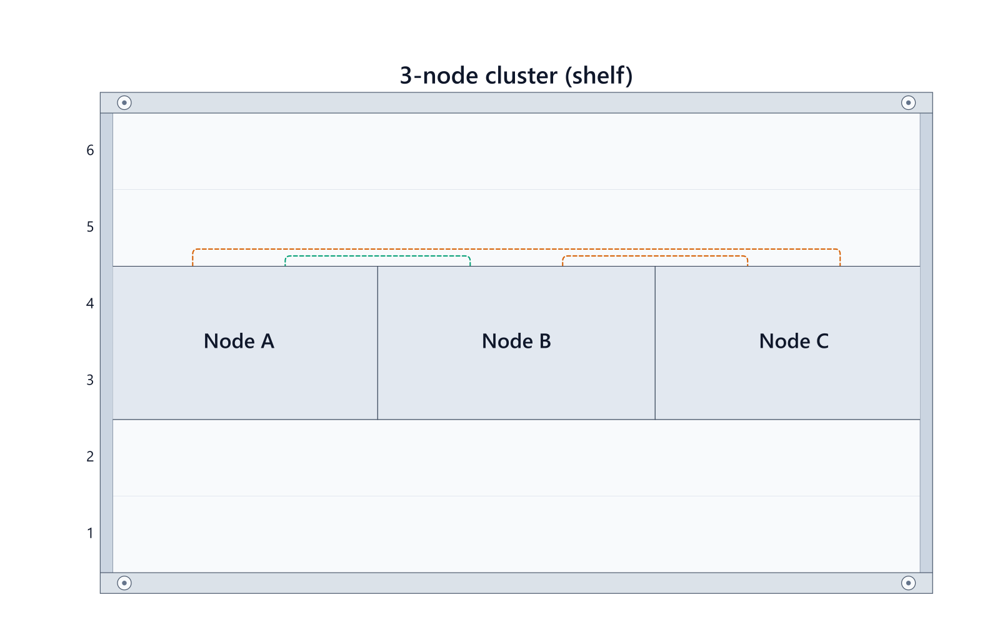

# RackDown

**Write the rack in text. RackDown draws it.**

RackDown is a text-first way to describe equipment racks and render them as SVG diagrams. Keep rack layouts in notes or Git, review changes as text, and render the same source in different tools.

```rackdown
rack "Example Rack" 8U 19in views front rear

8 switch "Core" as core
5 2U server "Host" as host
rear 2 pdu "Power" as power

core:1 -- host:"NIC 1" fibre category network
core:2 -- [[Upstream Rack]]
power:1 -- host:power1 category power
```

## See it in action

<a href="examples/generated/3-node-shelf.png">
  
</a>

Browse the [`examples/`](examples/) directory for rack layouts, clusters, routing, and shared rows.

## What it supports

- **Text-based rack layouts** — define rack size, equipment, U positions, front/rear views, aliases, and notes.
- **Connections and routing** — describe device-to-device links and external endpoints, with direct, orthogonal, lanes, or perimeter routing.
- **Optional device catalogue** — enrich generic devices with data from the [NetBox Community Device Type Library](https://github.com/netbox-community/devicetype-library). Explicit source details take precedence over catalogue defaults.
- **SVG output** — render diagrams with themes, accessible descriptions, and host-controlled styling.
- **Cable schedules** — export documented connections as Markdown or CSV, optionally filtered by category.
- **Integrations** — use the CLI, the browser playground, or the Obsidian adapter. A minimal Hugo integration proof is also included.

RackDown describes what you document; it does not validate whether the physical installation is complete or safe.

## Try it locally

Requirements: **Node.js 22+** and **pnpm 11.23.0** (the version pinned by the workspace).

```bash
git clone https://github.com/Diyan4444/RackDown.git
cd RackDown
pnpm install --frozen-lockfile
pnpm dev
```

Open <http://127.0.0.1:4173> for the playground.

## Command line

Build the CLI first:

```bash
pnpm --filter @rackdown/cli build
```

Then run it against a `.rackdown` file:

```bash
# Render an SVG
node packages/rackdown-cli/dist/cli.mjs render rack.rackdown -o rack.svg

# Check syntax and report diagnostics
node packages/rackdown-cli/dist/cli.mjs check rack.rackdown

# Create a cable schedule (Markdown by default)
node packages/rackdown-cli/dist/cli.mjs schedule rack.rackdown

# Export documented network connections as CSV
node packages/rackdown-cli/dist/cli.mjs schedule rack.rackdown --category network --format csv -o network-cables.csv
```

The `rackdown` executable is declared by the CLI package; the examples above invoke its built entry point directly so they work from a workspace checkout.

## Workspace

| Package or directory | Purpose |
| --- | --- |
| `packages/rackdown-core` | Parsing, resolution, layout, and SVG rendering |
| `packages/rackdown-devices` | Optional device catalogue and discovery |
| `packages/rackdown-cli` | Render, check, and schedule commands |
| `packages/obsidian-rackdown` | Obsidian integration |
| `apps/playground` | Browser-based playground |
| `apps/hugo-rackdown` | Minimal Hugo integration proof |
| `examples/` | Example source files and generated diagrams |

The core package has no runtime dependencies and can be used without a catalogue or host integration.

## Development

Run the workspace checks and build:

```bash
pnpm check
pnpm build
```

Start with the documentation that matches your task:

- [Authoring cheat sheet](docs/authoring-cheat-sheet.md) — common syntax and examples
- [Language specification](docs/specification.md) — full syntax, validation, and diagnostics
- [Architecture and integrations](docs/architecture.md) — how the parts fit together
- [Device catalogue and provenance](docs/upstream-catalogue.md) — upstream data, licensing, and generation
- [Contributing](CONTRIBUTING.md) — development and contribution guidance
- [Project history](HISTORY.md) — background and design notes

## Project status

RackDown is an experimental project, and packages/releases are not currently published. The Obsidian adapter has been tested on desktop; mobile validation remains outstanding.

Contributions are welcome, especially around documentation, authoring clarity, layout, and connection routing. Please open an [issue](https://github.com/Diyan4444/RackDown/issues) to discuss a change or submit a pull request.

## Licence

RackDown is licensed under [AGPL-3.0-only](LICENSE). The pinned upstream device data has separate [CC0-1.0 provenance](docs/upstream-catalogue.md).
